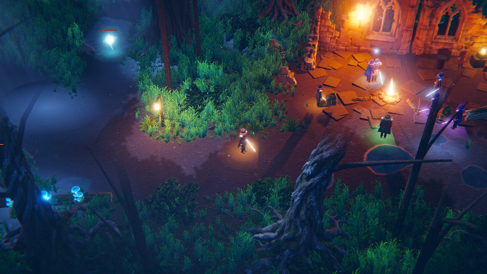

# Nightglade Online

เกม MMORPG แนวแอ็กชันบนเบราว์เซอร์ ฉากป่ายามค่ำคืนใต้แสงจันทร์ — เขียนด้วย JavaScript ล้วนและ Three.js
งานภาพหลักไม่ได้วาดด้วยโค้ด: **ตัวละครผู้เล่น** (ออกแบบ โมเดล กระดูก และท่าทางทุกท่า), **โมเดลฉาก** (ลำต้นและรากไม้ ซากกำแพงซุ้มหน้าต่าง เสา กองอิฐ หิน ขอนไม้ ตอไม้ เห็ดเรืองแสง คบเพลิง), **texture พื้น/หิน/เปลือกไม้**, **แผ่นหญ้า เฟิร์น ใบไม้** และ **VFX ของสกิล** สร้างด้วย Higgsfield ทั้งหมด
ส่วนที่ยังสร้างจากโค้ดคือรูปทรงภูมิประเทศ การจัดวางแผนที่ มอนสเตอร์ แสง หมอก และดนตรี

An action MMORPG that runs in the browser. The hero (design, model, skeleton and every move), the environment art (prop models, ground textures, foliage cards) and the skill VFX are generated with Higgsfield; the terrain shape, world layout, monsters, lighting and music are built in code.



## เล่นอย่างไร / How to run

**เล่นคนเดียว (ไม่ต้องติดตั้งอะไร)** — เปิด `mmorpg/index.html` ผ่านเว็บเซิร์ฟเวอร์ใดก็ได้ เช่น

```bash
cd mmorpg
python3 -m http.server 8000      # แล้วเปิด http://localhost:8000
```

เมื่อไม่พบเซิร์ฟเวอร์เกม ตัวเกมจะรันโลกทั้งใบในแท็บนั้นเอง พร้อมนักผจญภัย AI ที่ออกล่ามอนสเตอร์และคุยในแชต
(ถ้าเว็บนี้ถูก deploy บน GitHub Pages จะเล่นได้ที่ `/mmorpg/` ทันที)

**เล่นหลายคนจริง (multiplayer)**

```bash
cd mmorpg
npm install
npm start                        # http://localhost:8080  (ตั้งค่าได้ด้วย PORT, BOTS, MAX_PLAYERS)
```

ทุกคนที่เปิดหน้าเว็บจากเซิร์ฟเวอร์นี้จะอยู่ในโลกเดียวกัน เห็นกันและกัน สู้มอนสเตอร์ตัวเดียวกัน และแชตกันได้
ถ้าโฮสต์ตัวเกมไว้ที่อื่น ให้ชี้ไปยังเซิร์ฟเวอร์ด้วย `?server=wss://your-host/ws`

## การควบคุม / Controls

| ปุ่ม | การกระทำ |
| --- | --- |
| `W A S D` | เดิน |
| เมาส์ซ้าย (กดค้างได้) | ฟันจันทร์เสี้ยว — เล็งด้วยเมาส์ |
| `1` หรือคลิกขวา | คลื่นดาบจันทรา |
| `2` หรือ `Space` | ย่างก้าวเงา (พุ่ง, ปลดล็อก Lv 2) |
| `3` | จันทราระเบิด (Lv 4) |
| `4` | ดาราร่วง (Lv 6) |
| `R` | จันทรคราส — ท่าไม้ตาย (Lv 8) |
| `Q` / `E` | ยาฟื้นพลังชีวิต / มานา |
| `F` | พูดคุยกับ NPC, เก็บเห็ดเรืองแสง |
| `I` `J` `M` `Esc` | กระเป๋า, เควสต์, แผนที่, ตั้งค่า |
| `Enter` | แชต |
| ลากเมาส์ขวา / ล้อเมาส์ | หมุนกล้อง / ซูม |

บนมือถือและแท็บเล็ตจะมีจอยสติ๊กและปุ่มสกิลบนจอให้อัตโนมัติ

## ในเกมมีอะไร / What is in it

- **โลก**: 7 โซน — ซากวิหารเฝ้าจันทร์ (ค่าย), ป่ากระซิบ, ด่านไม้เก่า (ด่านร้างบนถนนฝั่งตะวันออก: รั้วไม้แหลม ซุ้มประตู ถัง ลัง เกวียน เพิงพัก คบเพลิง), หุบเห็ดเรืองแสง, ดงเขี้ยวสนธยา, ป่ารากเน่า และประตูผู้พิทักษ์ (บอส)
- **การต่อสู้**: สกิล 6 แบบ (รวมท่าไม้ตายจันทรคราส), คอมโบ 3 จังหวะ, คริติคอล, hit-stop, มอนสเตอร์ 4 ชนิด และบอสที่มีท่าโจมตีวงกว้างให้หลบ
- **ความก้าวหน้า**: เลเวล 1–12, ไอเทม 4 ระดับความหายาก, กระเป๋า/สวมใส่, ร้านค้า, เควสต์ต่อเนื่อง 5 ภารกิจ
- **ออนไลน์**: ผู้เล่นคนอื่น, แชต, มินิแมป; เซฟตัวละครอัตโนมัติ (localStorage เมื่อเล่นคนเดียว, ไฟล์บนเซิร์ฟเวอร์เมื่อออนไลน์)
- **ตัวละคร**: ฮีโร่ทรงจิบิพร้อมกระดูก 25 ชิ้น, ท่ายืนหายใจ วิ่ง พุ่ง คอมโบดาบ 3 จังหวะ ฟันคลื่น ร่ายเวท หมุนฟัน (จันทรคราส) คุกเข่าเก็บของ สะดุ้งเมื่อโดนตี และล้ม, ผ้าคลุม ชายผ้า และผมไหวตามการเคลื่อนไหว, ดาบสะพายหลังและมาอยู่ในมือเมื่อออกท่า, เลือกสีผ้าได้ 5 สี
- **ภาพ**: HDR + bloom + depth of field + ambient occlusion (เงาสัมผัสพื้น), เงาแสงจันทร์ลอดใบไม้, คบเพลิงที่ใกล้ตัวที่สุดทอดเงาจริง, ลำแสง volumetric, หญ้าไหวตามลมและแหวกเมื่อเดินผ่าน, แสงคบเพลิงกะพริบ
- **VFX สกิล**: ดาบไฟโค้ง, คลื่นดาบ, ทางไฟพุ่ง, วงระเบิดไฟ, ลูกไฟตก, เสาไฟ, พายุไฟหมุน, สุริยคราสไฟ, รอยไหม้บนพื้น — เลือกสีดาบอื่นแล้วเปลวไฟจะเปลี่ยนสีตาม
- **ภาษา**: ไทย / English สลับได้ในเกม

## โครงสร้างโค้ด / Layout

```
mmorpg/
  index.html, css/game.css     หน้าเกมและ HUD
  src/shared/                  โค้ดที่ใช้ร่วมกันทั้งเบราว์เซอร์และเซิร์ฟเวอร์
    world.js                   แผนที่: ความสูง, ทางเดิน, ตำแหน่งต้นไม้/หิน/ซาก, การชน
    data.js                    สกิล มอนสเตอร์ เควสต์ ไอเทม
    sim.js                     ตัวจำลองโลก (authoritative): AI, การต่อสู้, ดรอป, เควสต์, ผู้เล่นบอท
  assets/vfx/                  sprite sheet ของ VFX (สร้างด้วย Higgsfield)
  assets/env/                  โมเดลฉาก (.mesh + แผนที่สี/normal), texture พื้น, แผ่นพืช (สร้างด้วย Higgsfield)
  src/gfx/                     เรนเดอร์: ภูมิประเทศ หญ้า ต้นไม้ ซาก ตัวละคร post-processing
    assets.js                  ตัวโหลดโมเดล/texture/แผ่นพืชใน assets/env
    hero.js                    ตัวเล่นท่าของฮีโร่: ผสมคลิปท่าทาง แยกชั้นท่อนบน/ท่อนล่าง ผ้าไหว การหายใจ ดาบ แสงแบบการ์ตูน เส้นขอบ
    motion.js                  คลิปท่าทาง + การแก้ที่วางทับ (จากเครื่องมือจัดท่า) รวมเป็นคลิปที่เกมเล่น
    char-edits.js              การแก้ท่าของแต่ละตัวละคร (บันทึกจากเครื่องมือจัดท่า)
    actors.js                  มอนสเตอร์และบอส (สร้างจากโค้ด) + ตัวละครบล็อกแบบเดิมไว้เป็นตัวสำรอง
    flipbook.js                ตัวเล่น sprite sheet (วางบนพื้นหรือหันหากล้อง, เปลี่ยนสีตามดาบ)
    fx.js                      กำกับเอฟเฟกต์ของแต่ละสกิล: ใช้ชีตไหน ที่ไหน เมื่อไร
  src/game/                    ตัวเกมฝั่งผู้เล่น: อินพุต กล้อง เครือข่าย เสียง
  src/ui/                      HUD, กระเป๋า, เควสต์, แชต, แผนที่, ข้อความ 2 ภาษา
  server/server.js             เซิร์ฟเวอร์ WebSocket + เสิร์ฟไฟล์เกม
  dev/simtest.mjs              ทดสอบตัวจำลองแบบไม่มีจอ (`npm test`)
  dev/check_vfx.py             ตรวจว่าทุกเฟรมของแอนิเมชันอยู่ครบในกรอบ ไม่โดนตัดขอบ
  dev/build_vfx.py             แปลงแอนิเมชัน GIF เป็น sprite sheet + manifest
  dev/vfx.html                 หน้าดูเอฟเฟกต์ทุกชิ้น + ทดสอบการตัดช่องเฟรม
  dev/vfx_prompts.json         prompt ที่ใช้สร้างเอฟเฟกต์แต่ละชิ้น
  dev/build_env.py             แปลงโมเดล GLB, texture พื้น และแผ่นพืช เป็นไฟล์ที่เกมโหลด + manifest
  dev/env.html                 หน้าดูโมเดล texture และแผ่นพืชทุกชิ้น (มีมุมมองจากด้านบนไว้ดูทิศของโมเดล)
  dev/env_prompts.json         prompt ที่ใช้สร้างโมเดล texture และแผ่นพืชแต่ละชิ้น
  dev/make_lowpoly.py          แปลงรูปปั้นละเอียดเป็นโมเดลขนาดเกม: ลดโพลิกอน คลี่ผิว อบสีและรายละเอียด (normal map)
  dev/rig/hero.glb             โมเดลขนาดเกมของฮีโร่ ที่ส่งไปใส่กระดูก
  dev/auto_rig.py              ใส่กระดูกและน้ำหนักผิวให้ตัวเปล่าที่ยังไม่มีกระดูก จากรูปทรงของโมเดลเอง (หาเป้า รักแร้ คอ แล้ววางข้อต่อ)
  dev/build_char.py            แปลงตัวละคร (GLB พร้อมกระดูก + คลิปท่าทาง + แผนที่ผิว) เป็น <ชื่อ>.skin / <ชื่อ>.anim + manifest
  dev/animator.html            เครื่องมือจัดท่า: ปรับท่า คีย์เฟรม สร้างท่าใหม่ จังหวะท่าในเกม มุมดาบ (โค้ดอยู่ที่ src/tools/animator.js)
  dev/hero.html                หน้าดูฮีโร่: เล่นทุกท่าด้วยโค้ดชุดเดียวกับในเกม ดูส่วนที่ไหวได้ และมุมจับดาบ
  dev/char_prompts.json        prompt ที่ใช้ออกแบบฮีโร่ และรายชื่อคลิปท่าทางที่ใช้
  vendor/three.min.js          Three.js r187 (MIT)
```

ตัวจำลองโลก (`sim.js`) เป็นชุดเดียวกันทั้งสองโหมด: โหมดเล่นคนเดียวรันในแท็บ ส่วนโหมดออนไลน์รันบน Node แล้วส่ง snapshot ให้ผู้เล่น 10 ครั้งต่อวินาที

## VFX ทำอย่างไร / How the VFX are made

1. สร้างแอนิเมชันแต่ละท่าด้วย Higgsfield (โมเดล GPT Image 2.6, ส่งออกเป็น GIF เคลื่อนไหวบนพื้นดำ) — prompt ทั้งหมดอยู่ใน `dev/vfx_prompts.json` ทุก prompt บังคับให้เอฟเฟกต์อยู่ในกรอบโดยเว้นขอบดำอย่างน้อย 12% และให้ท่าที่เล่นครั้งเดียวดับสนิทภายในเฟรมที่ 16 (ตัวสร้างส่งกลับได้สูงสุด 16 เฟรม)
2. `python3 dev/check_vfx.py <โฟลเดอร์ GIF>` ตรวจทุกเฟรม: เฟรมไหนมีไฟแตะขอบ (แปลว่าโดนตัด) หรือท่าที่เล่นครั้งเดียวยังไม่ดับในเฟรมสุดท้าย จะรายงานและต้องสร้างชิ้นนั้นใหม่
3. `python3 dev/build_vfx.py <โฟลเดอร์ GIF>` ตรวจซ้ำแบบเดียวกัน (ไม่ผ่านจะไม่แพ็ก) แล้วจัดเฟรมลง sprite sheet (`assets/vfx/*.webp`) และเขียน `src/gfx/vfx-manifest.js` ซึ่งเก็บตำแหน่งช่อง, กรอบที่ภาพกินพื้นที่จริง (`box`), จุดยึด (`pivot`) และระยะของภาพ (`reach`)
4. `src/gfx/flipbook.js` เล่นชีต โดยคำนวณตำแหน่งช่องของแต่ละเฟรมฝั่ง JavaScript แล้วส่งให้ shader ตรง ๆ (ไม่ให้ GPU ปัดเศษเลขเฟรมเอง) ขนาดในเกมสั่งเป็นเมตรผ่าน `reach` เช่น วงไฟรัศมี 5 เมตร = `reach: 5`
5. `src/gfx/fx.js` เรียกเล่นชีตตามจังหวะของสกิล พร้อมสะเก็ดไฟ แสงวาบ คลื่นกระแทกบิดภาพ กล้องกระแทก และ hit-stop

เปิด `dev/vfx.html` ผ่านเซิร์ฟเวอร์ไฟล์ธรรมดา (เช่น `python3 -m http.server` ในโฟลเดอร์ `mmorpg/`) เพื่อดูทุกเอฟเฟกต์เล่นด้วยโค้ดชุดเดียวกับในเกม พร้อมเส้นกรอบช่อง จุดยึด และระยะ หน้านี้ทดสอบตัวเองด้วย: เทียบทุกเฟรมที่ shader แสดงกับช่องในชีต ว่าไม่มีเฟรมไหนหยิบผิดช่องหรือโดนขอบช่องตัด และเรนเดอร์ซ้ำแบบเปลี่ยนสี (ดาบสีฟ้า/เขียว/ม่วง) ที่ความสว่างสูง เพื่อยืนยันว่าขอบของแผ่นภาพยังดำสนิท ไม่เห็นเป็นกรอบสี่เหลี่ยม

อยากเพิ่มหรือเปลี่ยนเอฟเฟกต์: สร้าง GIF ใหม่ ตั้งชื่อไฟล์ตามคีย์ใน `SPEC` ของ `build_vfx.py` (ใส่ `pivot` กับ `reach` ของภาพนั้น) แล้วรันสคริปต์ซ้ำ

## ฉากทำอย่างไร / How the environment is made

1. วาดภาพต้นแบบของแต่ละชิ้นด้วย Higgsfield (GPT Image 2.6) — ชิ้นเดียว พื้นหลังเรียบ แสงนุ่มรอบด้าน เพื่อให้แปลงเป็น 3D ได้ดีและไม่มีเงาติดไปกับ texture
2. แปลงภาพเป็นโมเดล 3D พร้อม texture ด้วย Higgsfield image-to-3D (Tripo) ได้ไฟล์ GLB
3. Texture พื้น หิน เปลือกไม้ และแผ่นหญ้า/เฟิร์น/ใบไม้ (พื้นหลังโปร่งใส) ก็สร้างเป็นภาพเช่นกัน — prompt ทั้งหมดอยู่ใน `dev/env_prompts.json`
4. `python3 dev/build_env.py <โฟลเดอร์>` (ในนั้นมี `models/*.glb`, `tex/*.png`, `cards/*.png`) แปลงทุกอย่างลง `assets/env/` และเขียน `src/gfx/env-manifest.js`:
   - โมเดล: รวม mesh เป็นไฟล์ `.mesh` ขนาดเล็ก (ตำแหน่ง/uv 16 บิต, normal 8 บิต) วางฐานที่ y = 0 และย่อให้ด้านยาวสุดเป็น 1 หน่วย พร้อมแผนที่สีและ normal แบบ WebP — เกมจึงไม่ต้องมีตัวโหลด glTF
   - Texture พื้น: ทำให้ต่อกันได้ไร้รอยต่อ แล้วสร้าง normal map จากความสว่าง
   - แผ่นพืช: แยกแต่ละต้นออกจากภาพ จัดลงช่อง และเกลี่ยสีใบเข้าไปในส่วนโปร่งใสกันขอบดำ
5. ในเกม: `vegetation.js` วางลำต้น หิน ตอไม้ ขอนไม้ เห็ด และพืชคลุมดินทั่วแผนที่, `ruins.js` ประกอบซากโบสถ์ที่ลานเริ่มเกมจากชิ้นกำแพง เสา กองอิฐ และคบเพลิง, `outpost.js` ตั้งของในด่านไม้เก่าตามตำแหน่งใน `world.js` (ชุดเดียวกับที่เซิร์ฟเวอร์ใช้คำนวณการชน), `grass.js` ปูกอหญ้าแบบแผ่นภาพที่หันตามกล้องและไหวตามลม, `terrain.js` ผสม texture ทางเดินกับพื้นป่า

เปิด `dev/env.html` ผ่านเซิร์ฟเวอร์ไฟล์ธรรมดาเพื่อดูทุกชิ้นผ่านตัวโหลดของเกม

มุมกล้องใช้เลนส์ยาวจากระยะไกล (FOV 30°) แบบเกมแอ็กชัน RPG มุมสูง ภาพจึงแบนและจัดองค์ประกอบง่าย ในระดับคุณภาพสูงขึ้นไป คบเพลิงที่ใกล้ตัวละครที่สุดจะทอดเงาจริง (ทีละดวง ย้ายตามผู้เล่น) และตั้งแต่ระดับกลางมี ambient occlusion จาก depth buffer ช่วยให้ของ ราก และกอหญ้าดูติดพื้น (`post.debugAO = true` เพื่อดูเฉพาะชั้นนี้)

## ตัวละครทำอย่างไร / How the hero is made

ไม่มีส่วนไหนของฮีโร่ที่ปั้นด้วยโค้ด — โค้ดทำหน้าที่ "เล่น" ของที่สร้างมา และท่าทางแก้ได้ด้วยเครื่องมือจัดท่า ขั้นตอนเดียวกับที่สตูดิโอใช้: ปั้นละเอียด → ลดโพลิกอน → อบรายละเอียดลงแผนที่ผิว → ใส่กระดูก → จัดท่า

1. **ออกแบบ**: ภาพ key art แล้วให้ตัวสร้างภาพวาด "แผ่นโมเดล" มุมหน้าขนาดใหญ่ (2k, ท่า A-pose, มือกำหมัด, รูปทรงเป็นก้อนชัด, แสงเรียบ) และภาพดาบแยกชิ้น — prompt อยู่ใน `dev/char_prompts.json`
2. **ปั้น**: ยกภาพเป็นรูปปั้น 3 มิติด้วย Higgsfield (Tripo H3.1 แบบละเอียด) ได้ราว 297,000 สามเหลี่ยมพร้อมลายผิว 4096 — เบ้าตา จมูก ปาก หู ปอยผม ขนนก เข็มขัด เป็นรูปทรงจริง ไม่ใช่ภาพแปะบนผิวเรียบ
3. **ลดโพลิกอนและอบ**: `python3 dev/make_lowpoly.py <รูปปั้น.glb> <โฟลเดอร์>/hero --yaw -90 --head 1.8` ลดเหลือ 45,000 สามเหลี่ยม คลี่ผิวใหม่ (xatlas, ให้หัวได้พื้นที่ลายผิวมากกว่าตัว 1.8 เท่า) แล้ว "อบ" สีและรายละเอียดผิวของรูปปั้น (เป็น normal map) ลงบนโมเดลขนาดเกม ผลคือ `lowpoly.glb` (เก็บไว้ที่ `dev/rig/hero.glb`), `albedo.png`, `normal.png`
4. **ใส่กระดูกและท่าทาง**: บริการใส่กระดูก (Meshy rigging ผ่าน Higgsfield) รับ `dev/rig/hero.glb` แล้วเล่นคลิปจากคลังโมชั่นบนโมเดล คลิปละไฟล์ (ยืน วิ่ง พุ่ง ฟัน 3 แบบ หมุนฟัน ร่าย เก็บของ สะดุ้ง ล้ม) — โมเดลต้องหันหน้าไปทาง +z ไม่งั้นกระดูกจะวางผิดด้าน
5. **แปลงเข้าเกม**: `python3 dev/build_char.py <โฟลเดอร์>` (ในนั้นมี `hero/<ชื่อคลิป>.glb`, `hero/albedo.png`, `hero/normal.png`) ได้ `assets/env/hero.skin`, `hero.anim`, `hero_c.webp`, `hero_n.webp` และ `src/gfx/char-manifest.js` ระหว่างทาง:
   - **ท่าตรงกับต้นฉบับ**: บริการใส่กระดูกใหม่ทุกครั้งที่ขอคลิป สคริปต์ใช้โครงจากไฟล์คลิปวิ่งเป็นหลัก ย้ายท่าของคลิปอื่นเข้ามาด้วยมุมหมุนในพิกัดโลก แล้วพิมพ์ระยะคลาดของข้อต่อทุกคลิป (เฉลี่ยราว 0.5 ซม.)
   - **ใบหน้า**: หาผิวหน้าจากสีและรูปทรง (ตา คิ้ว ปาก อยู่บนผิวนั้น ส่วนผมหน้าม้าลอยอยู่ข้างหน้า) แล้วให้ผิวหน้าใช้ normal ของทรงกลมที่ฟิตกับหน้า — แสงจึงไล่บนหน้าเรียบแบบตัวการ์ตูน ไม่เกิดเงาแข็งในเบ้าตา
   - **ผ้าและผม**: โมเดลไม่มีกระดูกผ้า สคริปต์หาจุดที่ "ลอยห่างจากกระดูก" (ชายผ้าเอว ปลายขนนก ปลายผม) แล้วให้น้ำหนักการไหว ส่วนอกและฮู้ดได้น้ำหนักการหายใจ
   - **ดาบ**: `build_env.py` ยกภาพวาดดาบขึ้นเป็นโมเดลนูนมีความหนา มุมจับในมือคำนวณจากรูปทรงมือ ตอนไม่ใช้สะพายเฉียงแนบหลัง
6. **จัดท่า**: `dev/animator.html` (เครื่องมือจัดท่า) มีสองห้อง การแก้เก็บใน `src/gfx/char-edits.js` และเกมรวมเข้ากับคลิปตอนโหลด (`src/gfx/motion.js`)
   - **ห้องปรับท่า** วางการแก้ "ทับ" คลิปโดยไม่เขียนทับของเดิม — ทั้งคลิป เฉพาะช่วงเวลา หรือทุกท่าพร้อมกัน (บุคลิก) ตอนนี้ใช้แก้หัวที่ก้มต่ำเกินในทุกท่า และสร้างท่า "ยืนสบาย" จากท่ายืนตั้งท่า
   - **ห้องคีย์เฟรม** แก้ "ท่าจริง" ของคลิปทีละคีย์ หรือสร้างท่าใหม่จากศูนย์ คลิปจากคลังมาเป็นท่าทาง 30 ภาพต่อวินาทีซึ่งไม่มีคีย์ให้จับ เครื่องมือจึงแปลงเป็นคีย์ให้ (หาเฉพาะจังหวะสำคัญ จนเส้นโค้งที่ลากผ่านคีย์คลาดจากต้นฉบับไม่เกินค่าที่ตั้ง) แล้วคีย์ทุกอันแก้ท่า ลากย้ายเวลา ลบ หรือทำซ้ำได้ ตัวละครที่ยังไม่มีท่าเลยเปิดมาที่ห้องนี้พร้อมท่าแรกจากท่าตั้งต้นของโมเดล
   - **วงหมุน** คลิกส่วนไหนของตัว จะมีวงสีสามวงรอบส่วนนั้น (แกนของชิ้นนั้นเอง หรือแกนของตัวละคร) กับวงนอกที่หมุนตามมุมที่มอง ลากวงเพื่อหมุนรอบแกนนั้น เห็นองศาระหว่างลาก ตั้งให้หมุนทีละ 5° ได้
   - **อุปกรณ์** อยู่บนกระดูกของตัวเอง (`addPieces` ใน `src/gfx/assets.js`) จึงย้าย หมุน และใส่คีย์ได้เหมือนส่วนอื่นของตัว ตอนนี้คือดาบในมือกับดาบสะพายหลัง ชิ้นใหม่ทุกชิ้นให้เพิ่มทางนี้ ส่วนเสื้อผ้าที่เป็นผิวเดียวกับตัวให้เพิ่มกระดูกของชิ้นนั้นตอนแปลงโมเดล แล้วจะขึ้นในเครื่องมือเอง
7. **ในเกม** `src/gfx/hero.js` เล่นคลิปด้วย AnimationMixer ของ Three.js: ตาราง `MOVES` บอกว่าแต่ละคำสั่งของเกมใช้ช่วงไหนของคลิปไหน ท่าต่อกันด้วยการ cross-fade, ถ้ากำลังวิ่ง ท่าโจมตีจะใช้เฉพาะท่อนบนและขายังวิ่งต่อ, ท่าสะดุ้งซ้อนทับแบบ additive, ยืนสบายตอนปกติและยืนตั้งท่าตอนชักดาบ สิ่งที่โค้ดเพิ่มมีแค่ของที่กระดูกทำไม่ได้ (ผ้า/ผมตามแรงเฉื่อย หน้าอกพองตามจังหวะหายใจ) กับการให้แสงแบบภาพวาด: แรเงาสองโทนขอบนุ่ม (toon) เส้นขอบหมึกรอบตัว (วาดตัวซ้ำกลับด้านให้ใหญ่ขึ้นเล็กน้อย) และแสงขอบจากดวงจันทร์

เปิด `dev/animator.html` ผ่านเซิร์ฟเวอร์ไฟล์ธรรมดาเพื่อจัดท่า หรือ `dev/hero.html` เพื่อดูฮีโร่เล่นทุกท่า ทั้งสองหน้าใช้โค้ดชุดเดียวกับในเกม เครื่องมือจัดท่าใช้ได้กับตัวละครทุกตัวที่ผ่านขั้นตอนข้างบน และสั่งด้วยสคริปต์ได้ผ่าน `window.animator` (เลือกคลิป หมุนกระดูก ลากมือ/เท้าแบบ IK ใส่คีย์)

ผู้เล่นคนอื่น บอท และ NPC ใช้โมเดลฮีโร่ตัวเดียวกัน (ย้อมสีผ้าต่างกัน) มอนสเตอร์ยังเป็นโมเดลจากโค้ด

## ปรับแต่ง / Tuning

- คุณภาพกราฟิกเลือกได้ 4 ระดับในหน้าแรกหรือเมนูตั้งค่า (เกมจะลดความละเอียดให้อัตโนมัติถ้าเฟรมเรตต่ำ)
- ค่าพลังมอนสเตอร์ สกิล และเควสต์อยู่ใน `src/shared/data.js`
- แผนที่และจุดเกิดอยู่ใน `src/shared/world.js`
- ท่าทางและจังหวะท่าของฮีโร่แก้ใน `dev/animator.html` (บันทึกลง `src/gfx/char-edits.js`); ค่าตั้งต้นของจังหวะอยู่ใน `MOVES` ของ `dev/build_char.py`
